# Transfer Learning Optimization: Normalization Techniques and Gradient Dynamics

A PyTorch study of how the normalization layer in a fine-tuned classifier head affects convergence and gradient behaviour. An ImageNet-pretrained MobileNetV2 is adapted to CIFAR-10 with four otherwise identical heads (no normalization, Batch Norm, Layer Norm, Filter Response Norm), trained with and without gradient clipping and at different learning rates. Gradient histograms and loss landscapes are recorded along the way.

Written for the *Deep Learning* course (Spring 2025, Dr. Eftekhari). Everything lives in one notebook, runs are tracked with [Weights & Biases](https://wandb.ai/amiraaz/Normalization%20Techniques%20and%20Gradient%20Dynamics), and the full write-up is in the [English report](<Transfer Learning Optimization Assignment Report - English Version.pdf>).

## The idea in short

Normalization layers are usually credited with faster and more stable training. This project tests that in a fine-tuning setting, where the starting point is already close to a good solution and only a small part of the network moves.

1. Take MobileNetV2 with `IMAGENET1K_V1` weights and freeze everything except its last conv layer.
2. Put one small head on top. Only the normalization layer between the FC layer and the ReLU changes from model to model.
3. Change one thing per experiment: clipping on or off, then the learning rate.
4. Track more than accuracy: gradient histograms of the second FC layer for every epoch, and the loss on a 2D slice of the head's parameter space.

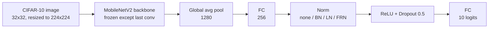

| Head | Normalizes over |
|---|---|
| Baseline | nothing |
| Batch Norm | each feature, across the batch |
| Layer Norm | each sample, across its 256 features |
| Filter Response Norm | each sample, divided by the RMS of its features |

<p align="center">
  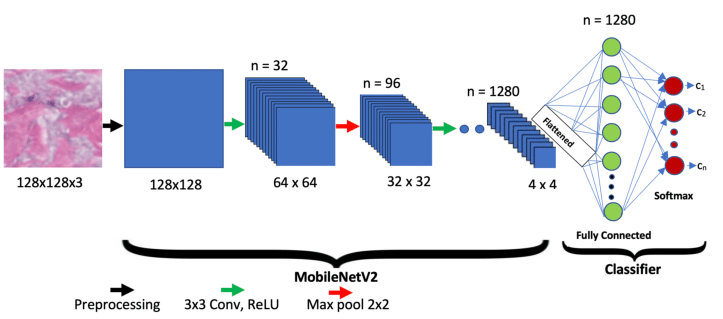
  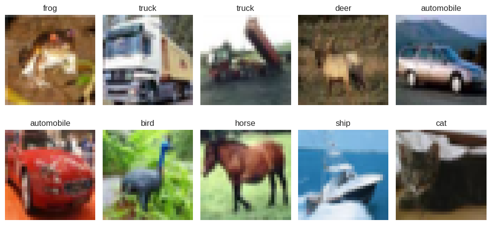
</p>

## What is implemented

| Part | What it does | Where in the notebook |
|---|---|---|
| Data | CIFAR-10 download, validation/test split, resize, crop, flip, ImageNet normalization | `load_dataset`, `preprocess` |
| Backbone | MobileNetV2 with all layers frozen except the last conv layer | `create_orig_model`, `freeze_params` |
| Heads | Baseline, BN, LN and FRN heads behind one factory | `create_adaptation_head`, `TransferModel` |
| Gradient analysis | Backward hooks on Conv, Linear, BN, LN and FRN layers, per-epoch histograms sent to W&B | `GradinetTracker` |
| Training | Adam, optional gradient clipping, validation loop, checkpoints saved locally and to W&B | `train_model`, `ExperimentManager` |
| Loss landscape | Loss over two random directions of the head parameters, as contour and 3D surface | `compute_head_loss_landscape`, `plot_loss_landscape_3d` |

## Repository layout

```
.
├── Transfer_Learning_Optimization_Normalization_Techniques_and_Gradient_Dynamics.ipynb
├── Transfer Learning Optimization Assignment Report - English Version.pdf
├── docs/figures/          figures used in this README
├── requirements.txt
└── LICENSE
```

## Getting started

```bash
git clone https://github.com/AmirAAZ818/Transfer-Learning-Optimization.git
cd Transfer-Learning-Optimization
pip install -r requirements.txt
```

Open the notebook in Colab or Jupyter. The W&B key is read from a Colab secret named `wandb` (outside Colab, replace that cell with `wandb.login()`), and `entity='amiraaz'` should be changed to your own W&B username. Then run it top to bottom.

## Results

### Setup

| | |
|---|---|
| Backbone | MobileNetV2, all layers frozen except the last conv layer |
| Data | CIFAR-10: 50,000 train, 8,000 validation, 2,000 test (the test set split 80/20) |
| Training | Adam, batch size 64, 15 epochs, cross-entropy, dropout 0.5, seed 42, one run per configuration |
| Preprocessing | Resize 232, random crop 224, horizontal flip, ImageNet mean and std |

| Experiment | Learning rate | Gradient clipping |
|---|---|---|
| 1. Convergence rate | 1e-3 | no |
| 2. Gradient clipping | 1e-3 | yes, max norm 1.0 |
| 3. Learning rate | 1e-2 | no |

<p align="center">
  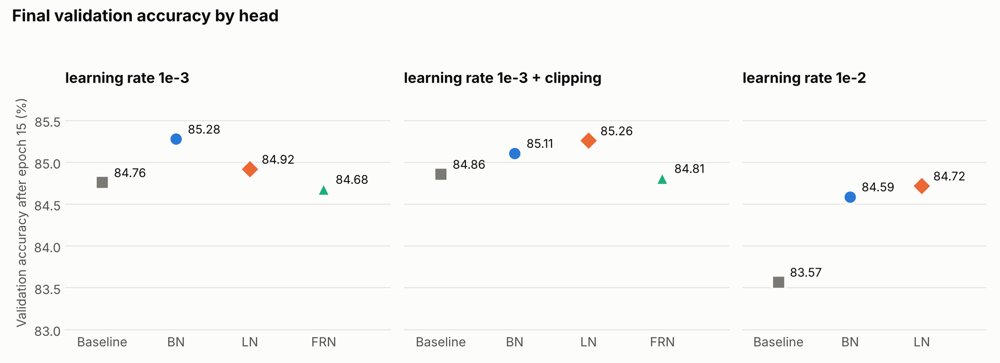
</p>

### Experiment 1: convergence rate

With identical settings the normalized heads converge faster. After the first epoch they are at 78.2 to 78.5% validation accuracy against 77.7% for the baseline, and Batch Norm finishes highest at 85.28%. Normalization smooths the loss surface, which makes optimization easier. The curves below are smoothed with a running average.

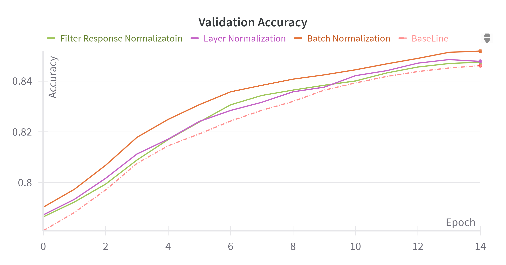

The loss landscapes of the trained heads are a single smooth basin for every head, which fits fine-tuning a pretrained model that already starts close to a minimum. Layer Norm has the flattest surface.

<p align="center">
  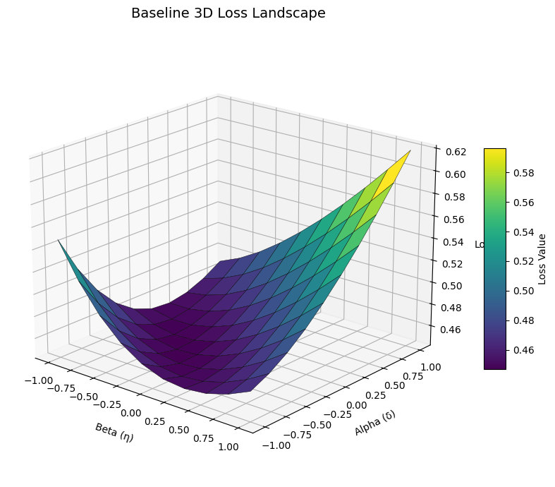
  
  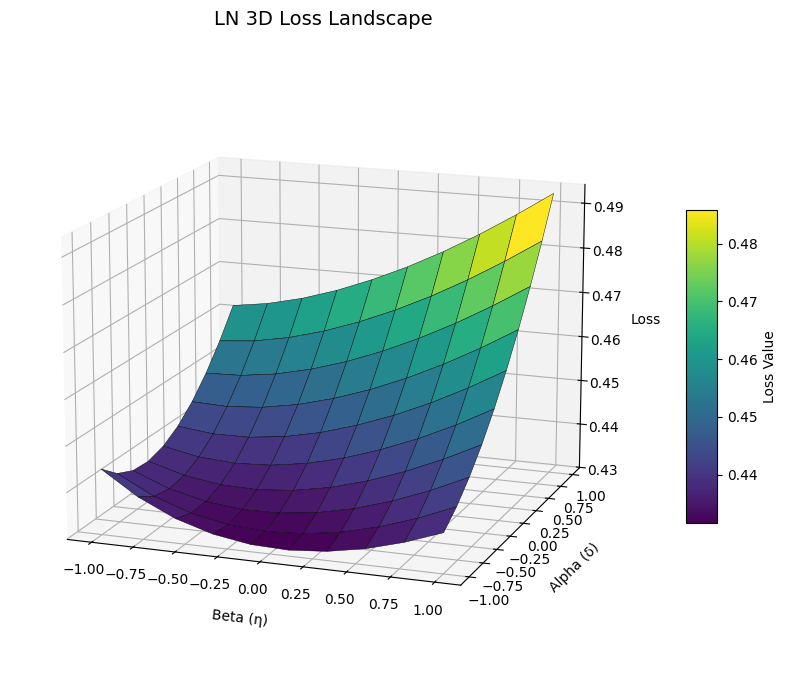
  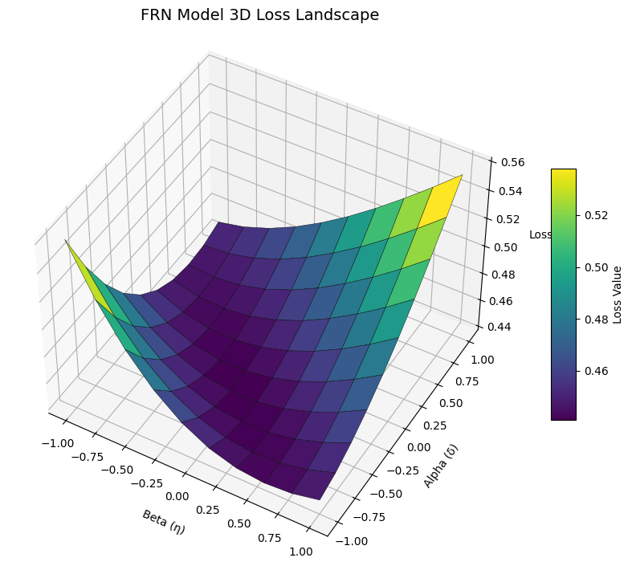
</p>

### Experiment 2: gradient clipping

At learning rate 1e-3, clipping the gradient norm at 1.0 changes the final accuracy of every head by less than 0.4 points. At this low learning rate the gradients are already small, so clipping has little to do. Layer Norm is the one case where clipping visibly smooths the validation loss.

<p align="center">
  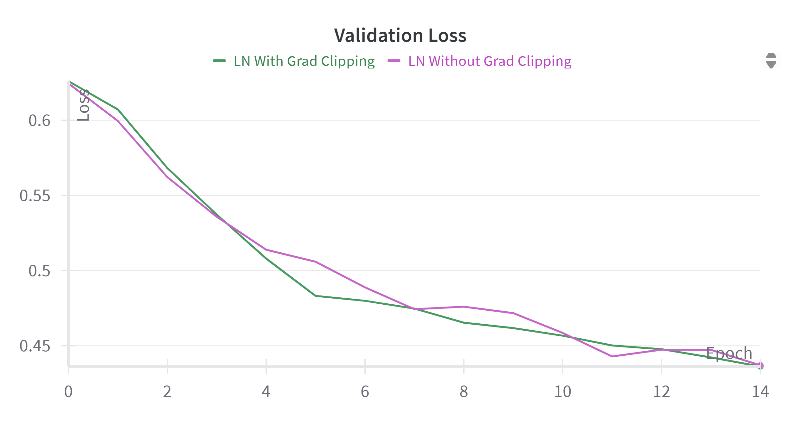
</p>

### Experiment 3: learning rate

With the learning rate raised to 1e-2 the baseline drops to 83.57%, while Batch Norm and Layer Norm hold at 84.59% and 84.72%. The baseline's validation loss ends near 0.53, against 0.47 and 0.48.

<p align="center">
  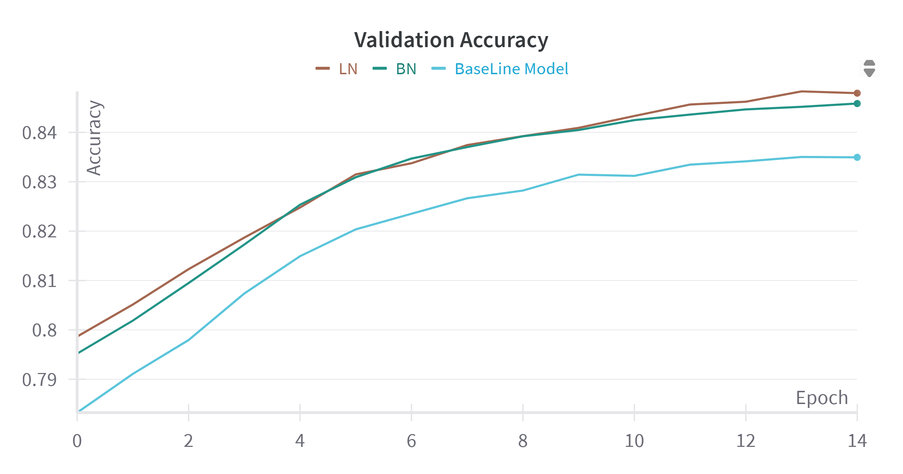
  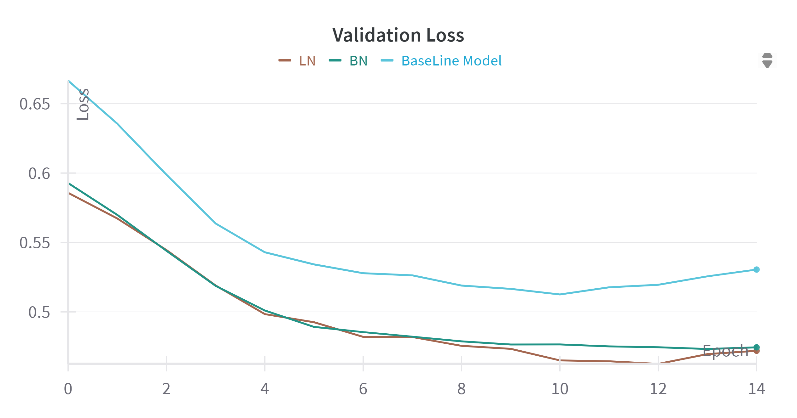
</p>

The learning rate also shows in the gradients. The histograms of the baseline's second FC layer spread out as it grows from 1e-3 to 1e-2 to 2e-1.

<p align="center">
  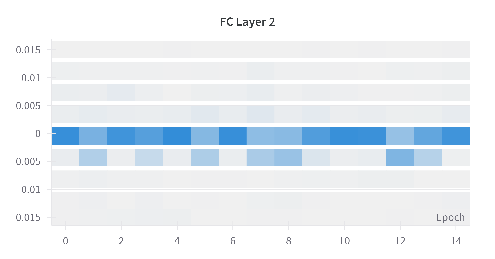
  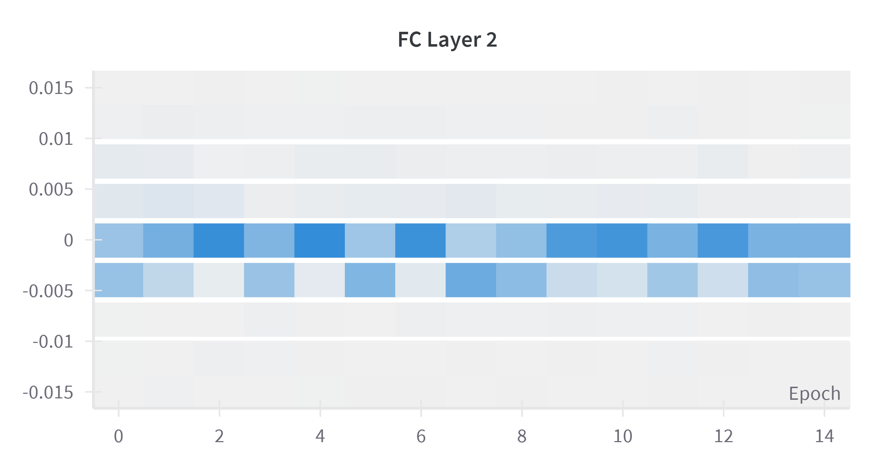
  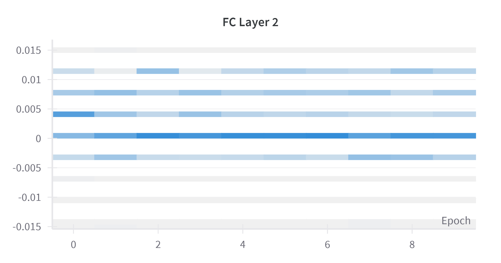
</p>

## References

- Ioffe and Szegedy, *Batch Normalization: Accelerating Deep Network Training by Reducing Internal Covariate Shift*, ICML 2015.
- Ba, Kiros and Hinton, *Layer Normalization*, arXiv:1607.06450, 2016.
- Singh and Krishnan, *Filter Response Normalization Layer: Eliminating Batch Dependence in the Training of Deep Neural Networks*, CVPR 2020.
- Sandler et al., *MobileNetV2: Inverted Residuals and Linear Bottlenecks*, CVPR 2018.
- Krizhevsky, *Learning Multiple Layers of Features from Tiny Images*, 2009.

## Author

Amirhossein Abolhassani Zeraatkar

Released under the [MIT License](LICENSE).
